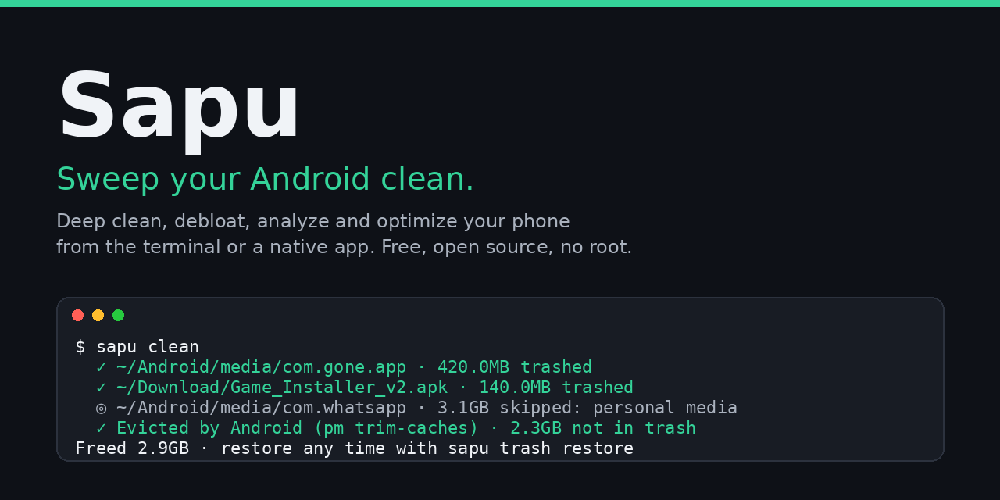
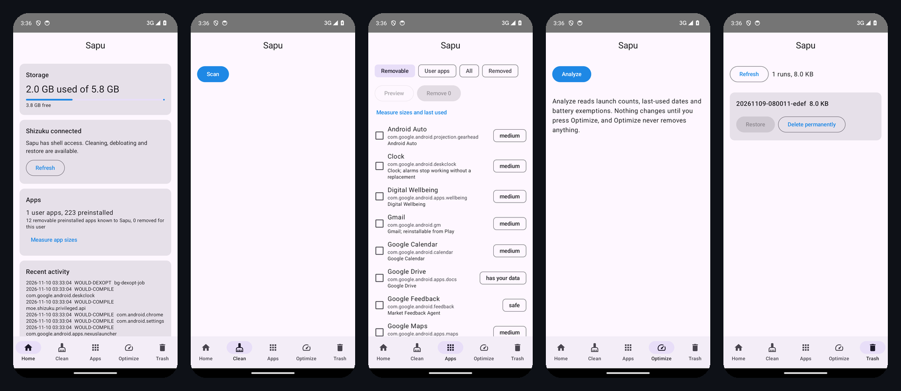

<div align="center">
  <h1>Sapu</h1>
  <p><b>Sweep your Android clean. Bersihkan sampah, buang bloatware, copot aplikasi, analisis penyimpanan dan pantau HP dari terminal. Gratis, open source, tanpa root.</b></p>
  <a href="LICENSE"></a>
  <a href="https://github.com/depapp/sapu/actions/workflows/check.yml"></a>
  <a href="https://github.com/depapp/sapu/releases"></a>
  <p><a href="README.md">English</a> · <a href="README.id.md">Bahasa Indonesia</a> · <a href="CHANGELOG.md">Changelog</a></p>
  
</div>

> Sapu berjalan di komputer dan berbicara dengan HP lewat `adb`, jadi ia bisa melakukan hal yang tidak boleh dilakukan aplikasi pembersih di HP sejak Android 11: mengukur cache setiap aplikasi, memangkasnya, membuang bloatware bawaan, dan membaca `Android/data`. Tidak ada yang dipasang di HP dan tidak perlu root.

## Fitur

- **Clean**: memindahkan ke tempat sampah sisa-sisa aplikasi yang sudah dicopot (dicocokkan dengan nama paket persis), APK installer lama, unduhan yang tidak selesai, cache thumbnail dan `LOST.DIR`, lalu meminta Android mengosongkan cache semua aplikasi (`pm trim-caches`, langkah permanen yang sama dengan Setelan > Penyimpanan > Hapus cache)
- **Uninstall**: mencopot aplikasi beserta folder `Android/data`, `obb` dan `media`-nya; `--bloat` menampilkan aplikasi bawaan dari katalog per vendor (Samsung, Xiaomi, OPPO, vivo, Infinix/Tecno, Google) dan mencopotnya untuk pengguna saat ini, bisa dikembalikan kapan saja
- **Analyze**: ringkasan penyimpanan (aplikasi, data, cache, kamera, unduhan, media WhatsApp, tangkapan layar, unduhan lama) dan penjelajah penyimpanan bersama dengan keyboard, pilih untuk memindahkan ke tempat sampah
- **Status**: CPU, memori, penyimpanan, baterai, suhu, jaringan dan proses teratas secara langsung dengan skor kesehatan
- **Optimize**: mengompilasi aplikasi yang paling sering dibuka, menjalankan bg-dexopt milik Android, dan mengaudit baterai
- **Aman secara bawaan**: setiap perintah yang menghapus punya `--dry-run`, berkas dipindahkan ke folder sampah di HP (`sapu trash restore`), paket yang dilindungi ditolak, media aplikasi chat dan bank tidak pernah disentuh, dan setiap tindakan dicatat (`sapu history`)

## Mulai Cepat

Anda perlu `adb` (Android platform-tools) dan USB debugging aktif di HP (Setelan > Tentang ponsel > ketuk *Nomor build* 7 kali, lalu Opsi pengembang > USB debugging).

```bash
# adb
brew install android-platform-tools      # macOS
sudo apt install adb                     # Debian/Ubuntu
scoop install adb                        # Windows

# sapu
curl -fsSL https://raw.githubusercontent.com/depapp/sapu/main/install.sh | sh   # macOS, Linux
brew install depapp/tap/sapu                                                     # Homebrew (macOS, Linux)
scoop bucket add sapu https://github.com/depapp/sapu && scoop install sapu       # Windows
# atau: go install github.com/depapp/sapu@latest
# atau unduh binary dari https://github.com/depapp/sapu/releases
```

Setelah itu, `sapu update` mengambil rilis terbaru dan memeriksa SHA256-nya sebelum mengganti dirinya sendiri.

```bash
sapu                         # Menu interaktif
sapu clean                   # Pangkas cache + sisa aplikasi + berkas sekali pakai
sapu uninstall               # Pilih aplikasi yang dicopot, beserta sisanya
sapu uninstall --bloat       # Pilih aplikasi bawaan yang dicopot
sapu analyze                 # Penjelajah penyimpanan
sapu status                  # Dasbor kesehatan langsung
sapu optimize                # Kompilasi aplikasi sering dipakai, bg-dexopt, audit baterai
sapu restore                 # Kembalikan aplikasi bawaan yang dicopot
sapu trash                   # Lihat / kembalikan / kosongkan tempat sampah Sapu di HP
sapu history                 # Apa yang Sapu lakukan, per sesi
sapu probe                   # Laporan perangkat anonim untuk isu rules
sapu update                  # Perbarui sapu
```

**Pratinjau dengan aman**

```bash
sapu clean --dry-run
sapu optimize --dry-run
sapu uninstall --dry-run com.example.app
sapu uninstall --bloat --list --json
sapu analyze --json
sapu status --json
sapu status --watch --interval 2s      # aliran NDJSON
```

## Contoh

<p align="center"></p>

```text
$ sapu clean

Clean Your Android

⚙ Samsung SM-A546E · Android 14 · Free space: 18.2GB

➤ Leftovers of uninstalled apps
  ✓ ~/Android/media/com.gone.app · 420.0MB trashed
  ✓ ~/Android/data/com.gone.app · 17.0MB trashed
  ◎ ~/Android/media/com.whatsapp · 3.1GB skipped: personal media of com.whatsapp

➤ Installer APKs
  ✓ ~/Download/Game_Installer_v2.apk · 140.0MB trashed

➤ App caches (system eviction, permanent)
  · 212 apps hold 2.4GB of cache
  ✓ Evicted by Android (pm trim-caches) · 2.3GB not in trash

======================================================================
Cleanup complete
Removed: 2.9GB · 12 items
Free space: 21.1GB (+2.9GB)
Trashed items are in /sdcard/.sapu/trash/20261109-075154-3f2a · restore with: sapu trash restore 20261109-075154-3f2a
======================================================================
```

## Keamanan

Sapu bisa menghapus sesuatu, jadi ia dibuat membosankan soal itu.

- Setiap berkas yang dihapus Sapu melewati satu corong (`internal/safety`) yang memvalidasi path dan **memindahkannya** ke `/sdcard/.sapu/trash/<run>/`. `sapu trash restore <run>` mengembalikannya; `sapu trash empty` bertanya dulu.
- Pengosongan cache aplikasi di `sapu clean` adalah satu-satunya langkah permanen: itu `pm trim-caches` milik Android sendiri, sama dengan Setelan > Penyimpanan > Hapus cache, dan juga mengosongkan cache aplikasi yang sedang berjalan. Langkah ini diberi label demikian di keluaran dan di `--dry-run`.
- Aplikasi dicopot untuk pengguna saat ini (`pm uninstall --user 0`); aplikasi bawaan tetap menyimpan APK-nya dan kembali dengan `sapu restore <paket>`.
- `protected_packages.yaml` (framework, layanan Play, keyboard, telepon, launcher, pengelola izin OEM) tidak pernah bisa dipilih; `data_protected.yaml` (WhatsApp, Telegram, bank, dompet digital, aplikasi autentikator, pengelola kata sandi) menjaga medianya bahkan ketika aplikasinya sudah hilang.
- Sisa aplikasi butuh bukti nama paket yang persis. Sapu tidak pernah menebak dari nama tampilan aplikasi.
- `sapu history` menampilkan setiap tindakan; `SAPU_NO_HISTORY=1` mematikan catatan. Tanpa telemetri.
- Lindungi sebuah path dengan menambahkannya ke `~/.config/sapu/whitelist`, satu path `/sdcard/...` per baris. `clean`, `uninstall` dan `analyze` menolak membuang apa pun di bawahnya.

Lihat [SECURITY.md](SECURITY.md).

## Aplikasi Android

Lebih suka tombol daripada terminal? Model keamanan yang sama hadir sebagai aplikasi native di [`android/`](android/) (Kotlin, Jetpack Compose, minimal Android 8). Unduh [`sapu-android.apk`](https://github.com/depapp/sapu/releases/latest/download/sapu-android.apk) yang sudah ditandatangani dari rilis terbaru (atau artefak `app-debug.apk` dari [workflow Check](https://github.com/depapp/sapu/actions/workflows/check.yml) untuk commit terbaru), atau bangun sendiri:

```bash
cd android && ./gradlew assembleDebug   # perlu JDK 17 dan Android SDK
```

<p align="center"></p>

Sejak Android 11 aplikasi tidak boleh membaca folder aplikasi lain atau menghapus cache-nya, jadi aplikasi ini memakai [Shizuku](https://shizuku.rikka.app) untuk akses setara shell: pasang Shizuku, jalankan sekali setiap boot lewat wireless debugging (tanpa root), lalu izinkan Sapu saat diminta. Tanpa Shizuku aplikasi tetap menampilkan penyimpanan, daftar aplikasi dan apa yang akan dibuang; menyapu, membuang bloatware dan memulihkan aktif begitu Shizuku terhubung.

Beranda menampilkan penyimpanan dan apa yang bisa Sapu lakukan sekarang; **Bersihkan** memindai sisa aplikasi, installer lama, unduhan tidak selesai dan cache thumbnail, menampilkan pratinjau, lalu menyapu ke `/sdcard/.sapu/trash`; **Aplikasi** menampilkan semua aplikasi beserta cache, ukuran dan tanggal terakhir dibuka, serta membuang atau memulihkan aplikasi bawaan dari katalog bersama; **Optimalkan** mengompilasi aplikasi yang paling sering kamu pakai, menjalankan dexopt latar belakang Android, dan mendaftar pengecualian baterai serta aplikasi yang tidak dibuka 90 hari; **Sampah** memulihkan atau menghapus hasil sapuan dari aplikasi maupun CLI. Antarmuka tersedia dalam bahasa Inggris dan Indonesia. Aplikasi dan CLI menulis tata letak trash dan manifest yang sama, jadi `sapu trash restore` bisa membatalkan apa yang dilakukan aplikasi, dan sebaliknya.

## Basis data rules

Pengetahuan yang membuat Sapu berguna tersimpan dalam YAML biasa di `internal/rules/data/`, dan aplikasi Android di `android/` membaca berkas yang persis sama, jadi satu kontribusi memperbaiki keduanya:

| Berkas | Isi |
|---|---|
| `protected_packages.yaml` | paket yang tidak pernah dicopot atau dinonaktifkan |
| `bloatware.yaml` | aplikasi bawaan yang aman dicopot, per vendor, dengan risiko dan catatan |
| `data_protected.yaml` | aplikasi yang folder penyimpanan bersamanya berisi data pribadi |
| `leftovers.yaml` | folder akar penyimpanan bersama dipetakan ke paket pemiliknya |
| `cleanable.yaml` | target sekali pakai dengan aturan umur dan aplikasi berjalan |

Tahu folder atau paket bloatware yang belum ada? Jalankan `sapu probe` dan tempel keluarannya ke sebuah isu: ia menampilkan paket bawaan yang belum dikenal basis data, tanpa nomor seri, akun, nama aplikasi pengguna, maupun nama berkas. `go test ./...` memeriksa berkas-berkas itu dari kontradiksi.

## Dengan agen AI

Beri tahu agen Anda: *Pasangkan Sapu untuk saya dengan membaca https://raw.githubusercontent.com/depapp/sapu/main/llms.txt*. Skill di `skills/sapu/` mengajari Claude Code, Codex dan Cursor untuk selalu menjalankan `--dry-run` lebih dulu dan menyerahkan keputusan akhir kepada Anda.

## Peta jalan

- `sapu optimize`: nonaktifkan alih-alih copot, pemeriksaan baterai lebih banyak
- Nama tampilan aplikasi dibaca dari APK (saat ini `app_names.yaml` yang dikurasi)
- Aplikasi Android di F-Droid; rules divalidasi di HP Samsung, Xiaomi, OPPO dan vivo sungguhan

## Lisensi

GPL-3.0. Sapu terinspirasi oleh [Mole](https://github.com/tw93/Mole), pembersih macOS karya Tw93, dan mengikuti model keamanannya; tidak ada kode yang dibagi dengannya.
