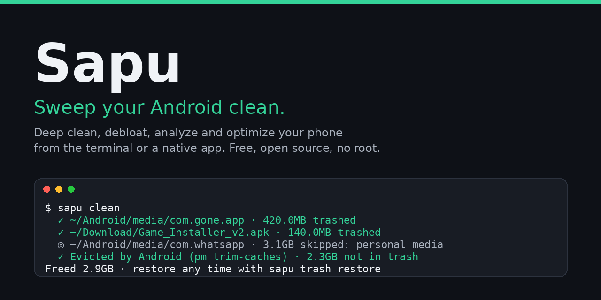
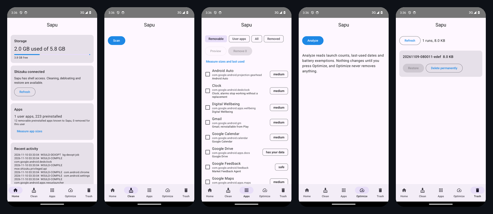

<div align="center">
  <h1>Sapu</h1>
  <p><b>Sweep your Android clean. Deep clean, debloat, uninstall, analyze storage and monitor your phone from the terminal. Free, open source, no root.</b></p>
  <a href="LICENSE"></a>
  <a href="https://github.com/depapp/sapu/actions/workflows/check.yml"></a>
  <a href="https://github.com/depapp/sapu/releases"></a>
  <p><a href="README.md">English</a> · <a href="README.id.md">Bahasa Indonesia</a> · <a href="CHANGELOG.md">Changelog</a></p>
  
</div>

> *Sapu* is Indonesian for "broom". Sapu runs on your computer and talks to the phone over `adb`, so it can do what cleaner apps on the phone are not allowed to since Android 11: measure every app's cache, trim it, remove preinstalled bloatware, and read `Android/data`. Nothing is installed on the phone and nothing needs root.

## Features

- **Clean**: trashes leftovers of apps you already uninstalled (matched by exact package name), old installer APKs, incomplete downloads, thumbnail caches and lost clusters, then asks Android to evict every app's cache (`pm trim-caches`, the same permanent step as Settings > Storage > Clear cache)
- **Uninstall**: removes apps with their `Android/data`, `obb` and `media` folders; `--bloat` lists preinstalled apps from a per-vendor catalog (Samsung, Xiaomi, OPPO, vivo, Infinix/Tecno, Google) and removes them for the current user, restorable any time
- **Analyze**: storage overview (apps, data, caches, camera, downloads, WhatsApp media, screenshots, old downloads) and a keyboard explorer of shared storage with trash-on-select
- **Status**: live CPU, memory, storage, battery, thermal, network and top processes with a health score
- **Safe by default**: every removing command has `--dry-run`, files are moved to a trash folder on the phone (`sapu trash restore`), protected packages are refused, chat and bank app media are never touched, and every action is logged (`sapu history`)

## Quick Start

You need `adb` (Android platform-tools) and USB debugging on the phone (Settings > About phone > tap *Build number* 7 times, then Developer options > USB debugging).

```bash
# adb
brew install android-platform-tools      # macOS
sudo apt install adb                     # Debian/Ubuntu
scoop install adb                        # Windows

# sapu
curl -fsSL https://raw.githubusercontent.com/depapp/sapu/main/install.sh | sh   # macOS, Linux
brew install depapp/tap/sapu                                                     # Homebrew (macOS, Linux)
scoop bucket add sapu https://github.com/depapp/sapu && scoop install sapu       # Windows
# or: go install github.com/depapp/sapu@latest
# or download a binary from https://github.com/depapp/sapu/releases
```

Later, `sapu update` fetches the newest release and checks its SHA256 before replacing itself.

```bash
sapu                         # Interactive menu
sapu clean                   # Trim caches + leftovers + disposable files
sapu uninstall               # Pick apps to remove, with leftovers
sapu uninstall --bloat       # Pick preinstalled apps to remove
sapu analyze                 # Storage explorer
sapu status                  # Live health dashboard
sapu optimize                # Compile most used apps, bg-dexopt, battery audit
sapu restore                 # Bring back a removed preinstalled app
sapu trash                   # List / restore / empty Sapu's trash on the phone
sapu history                 # What Sapu did, by run
sapu probe                   # Anonymized device report for a rules issue
sapu update                  # Update sapu itself
```

**Preview safely**

```bash
sapu clean --dry-run
sapu optimize --dry-run
sapu uninstall --dry-run com.example.app
sapu uninstall --bloat --list --json
sapu analyze --json
sapu status --json
sapu status --watch --interval 2s      # NDJSON stream
```

## Example

<p align="center"></p>

```text
$ sapu clean

Clean Your Android

⚙ Samsung SM-A546E · Android 14 · Free space: 18.2GB

➤ Leftovers of uninstalled apps
  ✓ ~/Android/media/com.gone.app · 420.0MB trashed
  ✓ ~/Android/data/com.gone.app · 17.0MB trashed
  ◎ ~/Android/media/com.whatsapp · 3.1GB skipped: personal media of com.whatsapp

➤ Installer APKs
  ✓ ~/Download/Game_Installer_v2.apk · 140.0MB trashed

➤ App caches (system eviction, permanent)
  · 212 apps hold 2.4GB of cache
  ✓ Evicted by Android (pm trim-caches) · 2.3GB not in trash

======================================================================
Cleanup complete
Removed: 2.9GB · 12 items
Free space: 21.1GB (+2.9GB)
Trashed items are in /sdcard/.sapu/trash/20261109-075154-3f2a · restore with: sapu trash restore 20261109-075154-3f2a
======================================================================
```

## Safety

Sapu can remove things, so it is built to be boring about it.

- Every file Sapu removes goes through one funnel (`internal/safety`) that validates the path and **moves** it to `/sdcard/.sapu/trash/<run>/`. `sapu trash restore <run>` puts it back; `sapu trash empty` asks first.
- The app cache eviction in `sapu clean` is the one permanent step: it is Android's own `pm trim-caches`, the same thing Settings > Storage > Clear cache does, and it also clears caches of running apps. It is labelled as such in the output and in `--dry-run`.
- Apps are removed for the current user (`pm uninstall --user 0`); preinstalled apps keep their APK and come back with `sapu restore <package>`.
- `protected_packages.yaml` (framework, Play services, keyboard, dialer, launcher, OEM permission managers) can never be selected; `data_protected.yaml` (WhatsApp, Telegram, banks, e-wallets, authenticators, password managers) keeps its media even when the app is gone.
- Leftovers need exact package evidence. Sapu never guesses from an app's display name.
- `sapu history` shows every action; `SAPU_NO_HISTORY=1` turns the log off. No telemetry.
- Protect a path by adding it to `~/.config/sapu/whitelist`, one `/sdcard/...` path per line. `clean`, `uninstall` and `analyze` all refuse to trash anything under it.

See [SECURITY.md](SECURITY.md).

## Android app

Prefer a button to a terminal? The same safety model ships as a native app in [`android/`](android/) (Kotlin, Jetpack Compose, minimum Android 8). Download the signed [`sapu-android.apk`](https://github.com/depapp/sapu/releases/latest/download/sapu-android.apk) from the latest release (or the `app-debug.apk` artifact of any [Check run](https://github.com/depapp/sapu/actions/workflows/check.yml) for the newest commit), or build it yourself:

```bash
cd android && ./gradlew assembleDebug   # needs JDK 17 and the Android SDK
```

<p align="center"></p>

Android does not let an app read other apps' folders or clear their caches since Android 11, so the app uses [Shizuku](https://shizuku.rikka.app) for shell-level access: install Shizuku, start it once per boot through wireless debugging (no root), and allow Sapu when asked. Without Shizuku the app still shows storage, the app inventory and what it would remove; sweeping, debloating and restore light up once Shizuku is connected.

Home shows storage and what Sapu can do right now; **Clean** scans leftovers, old installers, incomplete downloads and thumbnail caches, previews, then sweeps into `/sdcard/.sapu/trash`; **Apps** lists every app with its cache, size and last-opened date, and removes or restores preinstalled apps from the shared catalog; **Optimize** compiles your most used apps, runs Android's background dexopt and lists battery exemptions and apps you have not opened in 90 days; **Trash** restores or deletes runs made by either the app or the CLI. The UI is in English and Indonesian. The app and the CLI write the same trash layout and manifest, so `sapu trash restore` can undo what the app did and the other way round.

## Rules database

The knowledge that makes Sapu useful lives in plain YAML under `internal/rules/data/`, and the Android app in `android/` reads the very same files, so one contribution improves both:

| File | What it holds |
|---|---|
| `protected_packages.yaml` | packages that are never uninstalled or disabled |
| `bloatware.yaml` | preinstalled apps safe to remove, per vendor, with risk and note |
| `data_protected.yaml` | apps whose shared-storage folders are personal data |
| `leftovers.yaml` | root folders of shared storage mapped to the package that owns them |
| `cleanable.yaml` | disposable targets with age and running-app rules |

Know a folder or a bloatware package that is missing? Run `sapu probe` and paste the output into an issue: it lists the preinstalled packages the database does not know yet, with no serial, account, user app names or file names. `go test ./...` checks the files for contradictions.

## With an AI agent

Tell your agent: *Install Sapu for me by reading https://raw.githubusercontent.com/depapp/sapu/main/llms.txt*. The skill in `skills/sapu/` teaches Claude Code, Codex and Cursor to run every `--dry-run` first and to leave the final decision to you.

## Roadmap

- `sapu optimize`: disable instead of remove, more battery checks
- App display names read from the APK (today a curated `app_names.yaml`)
- Android app on F-Droid; rules validated on real Samsung, Xiaomi, OPPO and vivo phones

## License

GPL-3.0. Sapu is inspired by [Mole](https://github.com/tw93/Mole), the macOS cleaner by Tw93, and follows its safety model; it shares no code with it.
